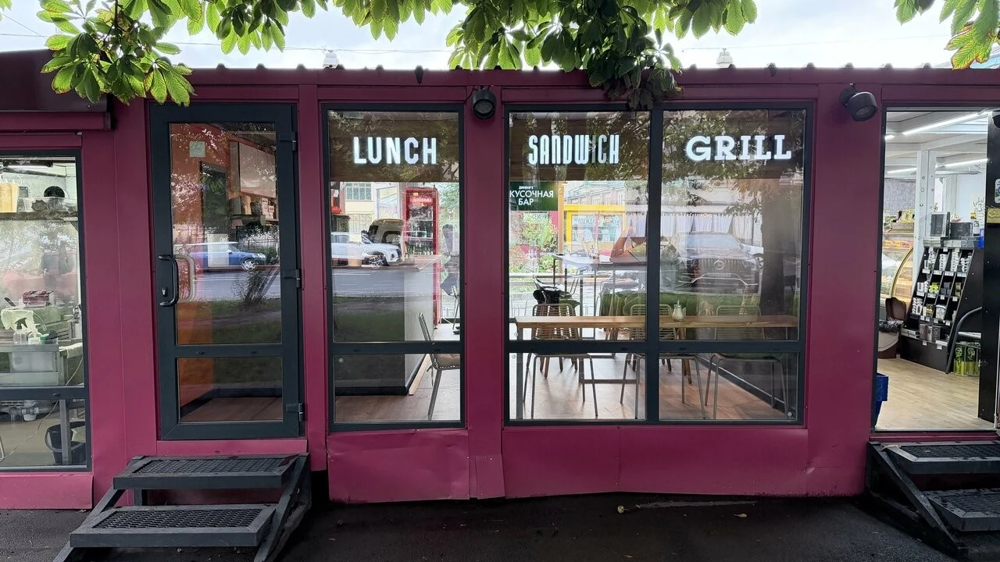

# Dikman's Deli

Static restaurant site for the menu, hot lunches, delivery and HoReCa supply information.

## Live

- GitHub Pages: https://ssrjkk.github.io/dn-s-Deli/
- Custom domain template: `CNAME.example` (`dikmans-deli.ru`). Activate it only after the domain is purchased and DNS is configured.

## Screenshot



## Run locally

```bash
python -m http.server 8080
```

Open http://localhost:8080/.

## Structure

- `index.html` — page markup, styles and scripts.
- `assets/photos` — menu and storefront photography.
- `assets/art` — logo and illustrations.
- `robots.txt` and `sitemap.xml` — crawler metadata.
- `CNAME.example`, `.nojekyll` and `404.html` — custom-domain and Pages support files.

## Checks

- Menu sections and prices render.
- Contact and delivery information is present.
- Layout works at mobile and desktop widths.

## Documentation

- [Russian README](README.ru.md)
- [Security policy](SECURITY.md)

## License

No license has been declared for this repository.

## Author

Sergey Sitnikov.

[Portfolio](https://ssrjkk.github.io/)
