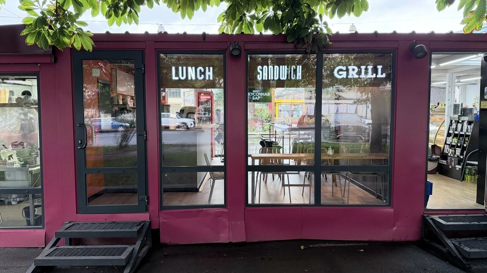

# Dikman's Deli

Статический сайт ресторана: меню, горячие обеды, доставка и поставки для HoReCa.

## Живой сайт

- GitHub Pages: https://ssrjkk.github.io/dn-s-Deli/
- Шаблон собственного домена: `CNAME.example` (`dikmans-deli.ru`). Активировать его только после покупки домена и настройки DNS.

## Скриншот



## Локальный запуск

```bash
python -m http.server 8080
```

Откройте http://localhost:8080/.

## Структура

- `index.html` — разметка, стили и скрипты страницы.
- `assets/photos` — фотографии меню и витрины.
- `assets/art` — логотип и иллюстрации.
- `robots.txt` и `sitemap.xml` — метаданные для поисковых систем.
- `CNAME.example`, `.nojekyll` и `404.html` — файлы поддержки собственного домена и GitHub Pages.

## Проверки

- Отображаются разделы меню и цены.
- Присутствуют контакты и информация о доставке.
- Вёрстка работает на мобильных и настольных ширинах.

## Документация

- [English README](README.md)
- [Политика безопасности](SECURITY.md)

## Лицензия

Для репозитория лицензия не объявлена.

## Автор

Сергей Ситников.

[Портфолио](https://ssrjkk.github.io/)
